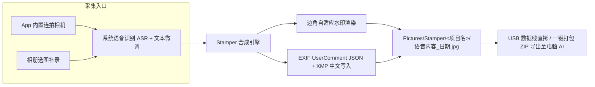

# Stamper — 施工/巡检语音水印与元数据相机 App 需求与架构设计

## 1. 背景与目标
在施工现场、设备安装巡检等高频拍摄场景中，工作人员每拍一张配件或点位照片，都需要记录对应的位置与对象信息（例如：`302教室东南角投影仪`）。

**Stamper** 旨在让用户在拍照后第一时间通过**语音输入**完成照片标注：
1. **批量信息卡水印**：在项目内一次给多张照片加上“项目名 + 拍摄时间 + 拍摄内容 + 地点”信息卡（另存到 `水印版/`）；拍照时的角落语音文字水印保留为可选项（默认关闭）
2. **文件名称**：`<语音录入内容>_<日期>.jpg`（如 `302教室东南角投影仪_20261125.jpg`）
3. **照片元数据 EXIF + XMP**（含精确时间、项目与语音内容，方便导出到电脑后由 AI Agent 零乱码读取、自动分类并插入报告文档）

---

## 2. 核心功能与交互流程



### 2.1 项目（批次）管理
- 支持创建、切换、重命名归档项目（例如：`实验楼弱电工程`、`3号楼消防巡检`），默认内置 `默认项目`。
- 项目详情页展示已归档照片网格，支持查看原图大图、查看写入的 EXIF/XMP 内容、修改备注重新生成、单张删除。
- **一键导出**：
  - **数据线直连**：照片直接存储在手机公共目录 `Pictures/Stamper/<项目名>/` 下，连接电脑即可按文件夹直接复制。
  - **打包分享**：支持将单个项目内所有成品图连同 `manifest.json` 索引清单打包为 `.zip`，一键通过微信/邮件/隔空投送发往电脑。

### 2.2 两种照片采集与语音录入方式
1. **App 内置连拍模式（推荐高频使用）**
   - 基于 `CameraX` 实现全屏取景，顶部显示当前归档项目与闪光灯切换。
   - 按下快门后，底部立即弹出语音录入面板（默认可开启“拍完自动开始听写”）。
   - 说完后实时显示识别文字（可重说或键盘微调），点击**保存并拍下一张**，后台完成水印与 EXIF 合成，无缝衔接连拍。
2. **系统相册批量补录**
   - 支持通过系统 Photo Picker 选择已有照片，逐张进行语音/文字补录并归档到指定项目。

> 注：早期版本的“后台监听系统相机 + 悬浮窗录入”已在 v1.5.0 移除。

### 2.3 批量信息卡水印
- 入口：项目相册右上角水印按钮（当前列表全部照片），或长按多选后底部“加水印”。
- 样式：彩色标题栏（默认工程蓝，项目名，可改）+ 白底信息行，行标签两端对齐：`拍摄时间`（`yyyy.MM.dd HH:mm`）、`拍摄内容`（照片语音备注；为空时取文件名去掉 `_yyyyMMdd` 后缀；`未备注_*` 不显示）、`地点`（手动填写或照片 GPS 识别，留空不显示）。
- 可调：显示行、四角位置、透明度（30%–100%）、大小（60%–160%）、标题栏颜色；设置按项目记住标题，全局记住其余样式。
- 输出：`Pictures/Stamper/<项目名>/水印版/<原文件名>`，保留原 EXIF（时间/GPS/相机）与 stamper.v1 元数据；重新生成时覆盖同名旧版本，原图不变。

### 2.4 语音转文字（System ASR）
- 调用 Android 原生 `SpeechRecognizer`（默认 `zh-CN` 中文普通话，兼容各大国产 ROM 自带离线/在线系统语音引擎，无需内置大体积模型）。
- 支持实时流式展示识别中的文字与音量动效；当系统语音不可用或环境嘈杂识别有偏差时，可直接在同一输入框内手动修改文字。

---

## 3. 水印与电脑 AI 元数据规范（核心契约）

### 3.1 独立开关与水印样式
- 设置项支持独立控制：
  - `开启画面水印`（默认关，推荐改用批量信息卡水印）：**仅显示语音录入信息**（**不带日期、不印项目名**；当备注为空时不绘制水印框）。
  - `开启 EXIF/XMP 元数据写入`（默认开）：将语音信息和拍摄时间作为隐藏属性嵌入 `.jpg` 文件内部。
- **位置可选**：`左下角（默认）`、`右下角`、`左上角`、`右上角`。
- **视觉自适应**：根据原图短边像素比例自适应计算字号、圆角、内边距与最大行宽（自动折行），采用**半透明深色圆角底衬 + 白色高对比度文字**，避免在白色墙面或暗光角落看不清字迹。
- **存储策略**：按项目建目录，**仅保存合成后的成品 JPEG**（默认 92% 高画质，自动根据原图 EXIF Orientation 摆正方向），节省手机存储空间。

### 3.2 图片文件命名规则（`.jpg` 文件名）
“图片文件名称”指的是照片保存在文件夹里显示的文件名（与嵌入照片内部的 EXIF 元数据相互独立、互为双保险）：
- **命名格式**：`<语音录入信息>_<yyyyMMdd>.jpg`（语音内容在前、日期在后，方便在电脑里按配件/位置名称自然归类排序）
  - 示例：`302教室东南角投影仪_20261125.jpg`
  - 同日重名自动追加序号：`302教室东南角投影仪_20261125_2.jpg`
  - 若未录入语音文字，兜底命名为：`未备注_20261125_100512.jpg`
  - 自动剔除 `/ \ : * ? " < > |` 等电脑文件名非法字符，过长文本自动截取前 40 个字符。

### 3.3 EXIF + XMP 双写规范（解决中文乱码，对电脑 AI 极度友好）
传统 EXIF 标准字段在不同电脑系统与解析库中容易出现中文乱码。为此，Stamper 在保留原图基础 EXIF（拍摄时间、相机型号、GPS 经纬度）的同时，采用 **EXIF JSON + XMP UTF-8 双写方案**：

| 存储位置 | 字段名 | 编码格式 | 示例内容 / 用途 |
| :--- | :--- | :--- | :--- |
| **EXIF** | `DateTimeOriginal` | ASCII | `2026:11:25 10:05:12`（拍摄时间） |
| **EXIF** | `GPSLatitude / Longitude` | Rational | 保留原图 GPS 或拍照时定位（若有权限） |
| **EXIF** | `ImageDescription` | UTF-8 | `2026-11-25 10:05:12 \| 302教室东南角投影仪` |
| **EXIF** | `UserComment` | UNICODE / UTF-8 JSON | 供电脑端 Python / Node / AI Skill 直接 `json.loads` 解析的结构化数据（见下） |
| **XMP (APP1)** | `dc:description` & `photoshop:Headline` | 标准 UTF-8 XML | Windows 文件属性“标题/备注”、macOS 预览、`exiftool` 零乱码直读中文 |

**`EXIF UserComment` 结构化 JSON 格式定义 (`stamper.v1`)：**
```json
{
  "schema": "stamper.v1",
  "project": "一号教学楼弱电改造",
  "capturedAt": "2026-11-25T10:05:12+08:00",
  "note": "302教室东南角投影仪",
  "watermarkApplied": true,
  "watermarkCorner": "BOTTOM_LEFT",
  "source": "in_app_camera"
}
```
> 后续电脑侧 AI Agent 只需读取照片的 `UserComment` JSON（或 XMP `dc:description` / 文件名），即可 100% 准确提取拍摄时间、所属项目和具体配件描述。

---

## 4. 技术栈与模块划分

- **开发语言与框架**：Kotlin 2.0 + Jetpack Compose (Material 3)
- **兼容版本**：`minSdk = 26` (Android 8.0) ~ `targetSdk = 35` (Android 15)
- **核心依赖**：
  - `CameraX` (`camera-core`, `camera-camera2`, `camera-lifecycle`, `camera-view`)：App 内置快速连拍
  - `AndroidX ExifInterface` + 自研轻量 `JpegXmpWriter`：EXIF 读写与 JPEG APP1 XMP UTF-8 注入
  - `Room` + `DataStore Preferences`：项目与归档历史本地数据库、全局水印与信息卡样式配置持久化
  - `Coil`：高效照片缩略图与大图预览加载
- **代码包结构规划 (`com.stamper.app`)**：
  - `data/`：Room 数据库（`ProjectEntity`, `PhotoRecordEntity`）、`SettingsRepository`、MediaStore 存储与 ZIP 导出器
  - `domain/stamper/`：`WatermarkRenderer`（Canvas 自适应绘制）、`MetadataWriter`（EXIF + XMP 双写引擎）、`FileNameSanitizer`
  - `speech/`：`SystemSpeechHelper`（封装 `SpeechRecognizer` 生命周期与流式回调）
  - `ui/`：
    - `home/`：项目列表、设置入口
    - `camera/`：内置连拍相机 + 底部即时语音录入面板
    - `project/`：项目照片网格、详情查看/重编辑、批量信息卡水印（`BatchWatermarkDialog`）、ZIP 分享导出
    - `settings/`：水印四角位置、字体大小比例、EXIF/水印/文件名开关配置与实时预览
